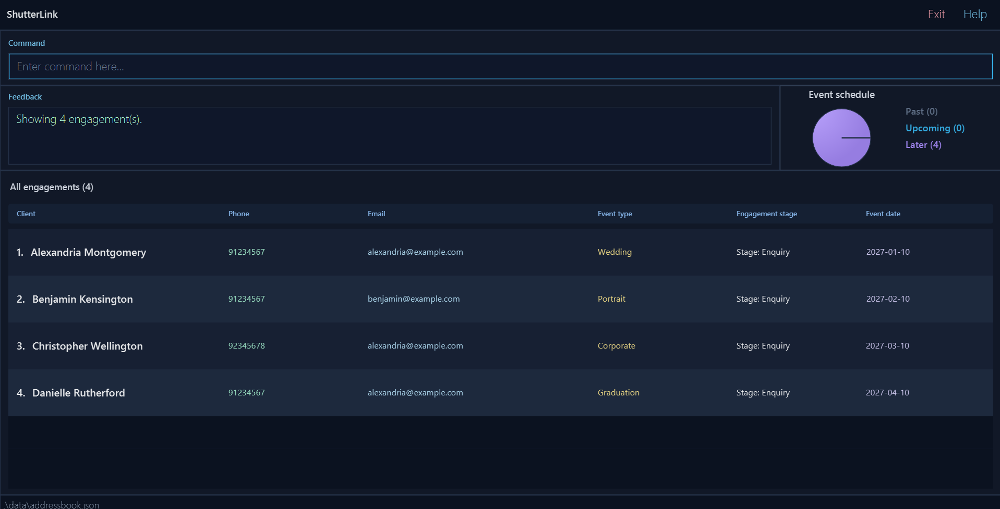
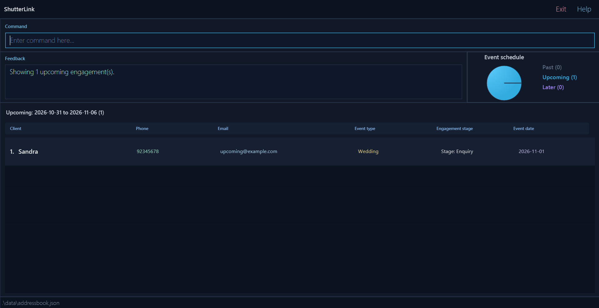

ShutterLink is a **desktop application for managing photography client engagements, optimized for use through a Command Line Interface (CLI)** while retaining the benefits of a Graphical User Interface (GUI). If you type quickly, ShutterLink can help you manage engagements faster than traditional GUI applications.

Use ShutterLink if you are an independent freelance event photographer who personally handles enquiries, upcoming shoots, and delivery follow-ups. Your records stay in a local file, and the app works without an Internet connection. It is intended for one photographer's records, rather than shared access by a team.

ShutterLink manages **engagements**, not separate client profiles. Each engagement contains a client's name, phone
number, and email address together with one event type, event date, and workflow stage. A repeat client can therefore
appear in multiple engagement records.

* Table of Contents
{:toc}

--------------------------------------------------------------------------------------------------------------------

## Quick start

1. Ensure that Java **25** is installed on your computer. In a terminal, run `java -version` and check that it reports version 25.<br>
   **Mac users:** Ensure you have the precise JDK version prescribed [here](https://se-education.org/guides/tutorials/javaInstallationMac.html).

1. Download `shutterlink.jar` from the [ShutterLink releases page](https://github.com/AY2627S1-CS2103T-T08-3/tp/releases). Use a release that includes the commands described in this guide; the project website may describe changes newer than an older JAR.

1. Copy the file to a folder you can write to. Use the same folder each time you launch ShutterLink, because data paths are relative to your terminal's current folder.

1. Open a terminal, `cd` to the folder containing the JAR file, and run `java -jar shutterlink.jar`.<br>
   On a first launch with no data file, ShutterLink displays sample engagements. On subsequent launches it loads your saved engagements. If your downloaded file has a different name, substitute that filename in the command.

1. Type a command in the command box and press Enter to execute it. For example, type **`help`** and press Enter to open the help window.<br>
   Some example commands you can try:

   * `list` : Lists all engagements.

   * `add n/John Doe p/98765432 e/johnd@example.com t/Wedding d/2026-12-20` : Adds an engagement for `John Doe` at the `Enquiry` stage.

   * `find t/Wed` : Finds engagements whose event type contains `Wed`.

   * `list sort/date` : Orders engagements by event date.

   * `upcoming` : Shows events dated today through the next six dates.

   * `exit` : Exits the app.

1. Refer to the [Features](#features) section below for details of each command.

The screenshots below use fictional engagements in the current interface. Your record contents and upcoming date window will differ.



## Finding your way around

| Area | What to use it for |
| --- | --- |
| **Command** | Type one command, then press Enter. Accepted commands clear the input; rejected commands retain the text for correction. |
| **Feedback** | Read the command result or error. A possible-typo warning can appear after a successful add or edit. |
| List heading | Check which view is active and how many engagements it contains. |
| Engagement cards | Read each displayed index, client name, phone, email, event type, event date, and stage. Scroll to see additional cards. Double-click an engagement card, or select it with the keyboard and press Enter, to open its complete details. |
| **Help** | Open the command reference using the button, `help`, or F1. |

The displayed index is a temporary position, not a permanent client ID. After a search, sort, add, edit, advance, or deletion, check the list again before choosing an index. `edit 1` affects the first engagement currently shown, which may be a different engagement from the first one in the full list.

Hover over a clipped field to read its full value in a tooltip, or double-click the engagement card to view all fields in a
resizable details dialog. To use the keyboard, press Tab until the engagement list is focused, select a row using
the Up and Down arrow keys, and press Enter. Inside the dialog, use Tab to focus the details text for selection and
copying, or use **Copy details** to copy all fields to the clipboard. Press Escape to close the dialog. You can also
widen the main window and use the horizontal scrollbar where available. The overview screenshot uses a wider window
to show all six columns.

### Try a client workflow

Use these commands in order to follow an example engagement. Replace the sample client details with your own when you start using the app for real work.

1. Add an engagement that has already been booked:

   ```text
   add n/Avery Tan p/+65 9123 4567 e/avery@example.com t/Wedding d/2026-12-20 s/Booked
   ```

1. Select that engagement by searching its email address:

   ```text
   find e/avery@example.com
   ```

   On your first run of this example, the new engagement is the only match and has displayed index 1. If other engagements match, check their event details and use the correct displayed index instead.

1. Once the shoot is finished, advance the selected engagement from `Booked` to `Shot Completed`:

   ```text
   advance 1
   ```

   The full list reappears after the stage change, so index 1 may now identify a different engagement.

1. Search again before updating that engagement's payment stage:

   ```text
   find e/avery@example.com
   edit 1 s/Awaiting Payment
   ```

   Enter the two commands separately, pressing Enter after each one. Recheck the displayed index if your search returns more than one engagement.

1. Run `list sort/date` to review all event dates, or `upcoming` to prepare for the next seven calendar days. The example wedding appears in `upcoming` only when 2026-12-20 is within that window.

Repeating the same add command gives a duplicate error. Find and edit the existing engagement instead. To record a different event for a repeat client, add another engagement with its own event type or date; editing one engagement does not update the client's other engagements.

--------------------------------------------------------------------------------------------------------------------

## Features

<div markdown="block" class="alert alert-info">

**:information_source: Notes about the command format:**<br>

* Words in `UPPER_CASE` are the parameters to be supplied by the user.<br>
  For example, in `add n/NAME`, replace `NAME` with a value such as `John Doe`.

* Items in square brackets are optional.<br>
  For example, `edit INDEX [n/NAME]` can be used as `edit 1 n/John Doe` or with another editable field.

* Prefixed parameters can be in any order.<br>
  For example, if the command specifies `n/NAME p/PHONE_NUMBER`, `p/PHONE_NUMBER n/NAME` is also acceptable.
  For `edit`, the `INDEX` must appear before the prefixed parameters.

* Enter one command per line. Use a regular space before each prefix, such as `n/` or `d/`, and use only the prefixes shown in that command's format. Do not type quotes around multiword values: use `s/Awaiting Payment` directly.

* Command words and prefixes are case-sensitive, except that `list`, `upcoming`, and the `sort/date` option are
  case-insensitive. Stage values are also case-insensitive.<br>
  For example, `add ... s/booked` is accepted, while `ADD ...` and `N/John Doe` are not.

* Do not repeat a prefix in the same command. A repeated prefix is rejected instead of silently choosing one value.

* Commands that take no parameters reject unexpected input unless their command section states otherwise.<br>
  For example, `help 123` is rejected because `help` takes no parameters.

* If you are using a PDF version of this document, be careful when copying and pasting commands that span multiple lines as space characters surrounding line-breaks may be omitted when copied over to the application.
</div>

### Field formats

Leading and trailing whitespace around values is ignored when commands are parsed. The following constraints apply:

| Field | Prefix | Accepted format and stored value |
| --- | --- | --- |
| Name | `n/` | Letters (including accented letters such as `é`), digits, spaces, apostrophes (`'`), hyphens (`-`), periods (`.`), and slashes (`/`); the first character must be a letter or digit. For example, `O'Connor`, `Anne-Marie Tan`, and `John Tan Jr.` are accepted. Relation markers `s/o`, `d/o`, `a/l`, `a/p`, and `w/o` (in any letter case) can be used inside a name, e.g. `n/Raj s/o Kumar`. Other text such as `x/` after a space is read as a parameter, so avoid it inside names. Repeated whitespace is stored as one space, so `Amy  Lim` is stored as `Amy Lim`. |
| Phone number | `p/` | 8–15 digits, with an optional leading `+`. Spaces and hyphens are accepted but removed when the number is stored and displayed. |
| Email | `e/` | `local-part@domain`, up to 254 characters. The local part uses alphanumeric groups separated by `+`, `_`, `.`, or `-`; those special characters cannot start or end the local part or occur consecutively. The domain has at least two dot-separated labels. Each domain label must start and end with an alphanumeric character. Hyphens are allowed inside a domain label, but they cannot occur consecutively. For example, `john@my-domain.com` is accepted, while `john@my--domain.com` is rejected. The final domain label must contain at least two characters. The address is stored in lowercase. |
| Event type | `t/` | 1–40 letters, digits, spaces, or hyphens, with at least one letter or digit. Repeated whitespace is stored as one space. |
| Event date | `d/` | A real calendar date in `YYYY-MM-DD` format, with a year from `0001` to `9999`. |
| Stage | `s/` | `Enquiry`, `Booked`, `Shot Completed`, `Awaiting Payment`, or `Delivered`. Matching ignores capitalization, and the canonical spelling is displayed. |

An `INDEX` is a positive integer referring to the numbering in the list currently displayed. Search, sort, and
upcoming views can therefore change which engagement an index identifies.

**Both phone and email are required.** You cannot leave either field empty when adding, or clear it with `edit 1 p/` or `edit 1 e/`. Omit a field from an edit command to retain its current value. Event dates may be in the past, so completed work can remain in your records.

Phone formatting does not infer country codes: `+65 9123 4567` is stored as `+6591234567`, while `91234567` stays `91234567`. The leading `+` is retained and matters when checking duplicate phone numbers. Use a consistent format for repeat clients.

### Viewing help: `help`

Opens a concise in-app command reference and provides a link to this User Guide.

Format: `help`

Use F1 or the **Help** button for the same panel. Scroll through the command reference, then press Escape or use **Close** to return to the command field. The underlying list and its indexes are retained. `help 123` is rejected because Help takes no arguments.


### Adding an engagement: `add`

Adds a client engagement to ShutterLink. The stage is optional and defaults to `Enquiry`.

Format: `add n/NAME p/PHONE_NUMBER e/EMAIL t/EVENT_TYPE d/EVENT_DATE [s/STAGE]`

Examples:
* `add n/John Doe p/98765432 e/johnd@example.com t/Wedding d/2026-12-20`
* `add n/Betsy Crowe p/+65 9123 4567 e/betsycrowe@example.com t/Portrait d/2027-01-15 s/Booked`

Supported stages are `Enquiry`, `Booked`, `Shot Completed`, `Awaiting Payment`, and `Delivered`.
Stage matching is case-insensitive, so `s/booked` is stored and displayed as `Booked`.

An engagement is considered a duplicate when its name, normalized phone number, email address, event type, and event
date match an existing engagement; the stage is not part of duplicate identity. Name, email, and event type comparisons
ignore capitalization. A repeat client can still have multiple engagements with different event types or dates.

After a successful add, the complete list is displayed in insertion order. If the new engagement shares a phone
number or email address with another client identity, ShutterLink also displays a possible-typo warning.

For example, adding `Avery Tan` and later adding `Avery Tna` with the same phone and email creates separate client identities and produces a warning such as:

```text
New engagement added: Avery Tna | Wedding | 2026-12-20 | Enquiry.
Warning: possible typo. Shares details with #1 Avery Tan (same phone and email).
If this is a mistake, fix the wrong engagement with edit INDEX or delete INDEX.
```

Each `#INDEX` refers to the full list shown after the command, and the text in brackets states which details are
shared. A client with several engagements is listed once, and at most three clients are named before the warning
summarizes the rest as `and N more`. The add has already succeeded; inspect the numbered records in the warning and correct the mistaken one using `edit` or `delete`. A warning is not a duplicate rejection. For repeat engagements with the same name, phone, and email, a different event type or date is accepted without this client-identity warning.

A duplicate is rejected even if the new stage differs. Change the existing engagement's stage using `edit INDEX s/STAGE` instead.

### Listing and sorting engagements: `list`

Use `list` to return to all client engagements after a search or sorted view.
Use `list sort/date` to review all engagements from the earliest event date to the latest.
Past events are included. Engagements on the same date stay in the order they were added.

Formats:
* `list` — all engagements in insertion order.
* `list sort/date` — all engagements by ascending event date.

The heading is `All engagements (N)` or `All engagements by event date (N)`, respectively.
The result panel reports `Showing N engagement(s).` With no saved engagements, it reports
`No engagements to display.` Here, `N` is the number of displayed engagements.

Examples:
* `list sort/date` brings earlier shoots to the top, including completed dates.
* `list` restores insertion order after sorting.
* `LIST SORT/DATE` also works: the list command, prefix and sort value are case-insensitive.

Each command starts from all records, replacing the previous search or sort.
Displayed indexes are recalculated; subsequent edit, advance, and delete commands use the indexes currently shown.
Sorting does not change the saved records or their insertion order. Restarting restores insertion order.

Only the `sort/` prefix and the value `date` are supported. Spaces and tabs may separate arguments,
but the command must occupy one line. Use `find s/STAGE` to filter by stage; `list` does not accept a stage filter.

| Invalid input | Feedback |
| --- | --- |
| `list sort/name` | `Invalid sort option. Use list sort/date.` |
| `list sort/` | `Empty value for sort/.` |
| `list sort/date sort/date` | `Duplicate parameter: sort/.` |
| `list stage/Booked` | `Unsupported parameter: stage/.` |
| `list 3` or `list sort/date extra` | `Invalid command format. Usage: list [sort/date]` |

Unsupported prefixes are rejected. Invalid list commands leave both the data and current view unchanged.

### Viewing upcoming events: `upcoming`

Shows all client engagements scheduled for **today and the following six calendar dates**, inclusive.
This is seven calendar days in total, using your computer's local date and timezone when you run the command.

Format: `upcoming`

* Results start from all saved engagements, replacing any previous search or sort.
* Events are sorted from earliest to latest; events on the same date retain insertion order.
* Past events and events seven or more days after today are excluded.
* Displayed indexes start at 1. Edit, advance, and delete use the indexes in this view.
* The heading shows `Upcoming: START_DATE to END_DATE (N)` and feedback shows `Showing N upcoming engagement(s).`
* With no matching events, the list is empty and feedback is `No events scheduled from START_DATE to END_DATE.`
* Records are not changed or saved by this command. Use `list` to restore all engagements in insertion order.

For example, running `upcoming` on **2026-10-14** includes dates **2026-10-14 through 2026-10-20**.
An event on 2026-10-21 is outside that window. With two matches, the heading is
`Upcoming: 2026-10-14 to 2026-10-20 (2)` and the feedback is `Showing 2 upcoming engagement(s).`

The command is case-insensitive and takes no arguments: `UPCOMING` works, but `upcoming 7` and
`upcoming sort/date` return `Invalid command format. Usage: upcoming` without changing the current view.
The date window does not advance automatically at midnight; run `upcoming` again to refresh it.
If the date window cannot be calculated, ShutterLink asks you to check the system date and leaves the view unchanged.



This screenshot illustrates the window at capture time. It includes every stage, including `Delivered`, if the event date is in range; it is not a stage filter.

### Editing an engagement: `edit`

Edits one or more details of an existing engagement. Use `s/STAGE` to correct or directly set its stage.

Format: `edit INDEX [n/NAME] [p/PHONE_NUMBER] [e/EMAIL] [t/EVENT_TYPE] [d/EVENT_DATE] [s/STAGE]`

* Edits the engagement at the specified `INDEX`. The index refers to the number shown in the current list and must be a positive integer.
* At least one of the optional fields must be provided.
* Existing values will be updated to the input values.
* The stage may be moved forward or backward to any supported value.
* If every supplied value is the same as the current value, nothing is changed: ShutterLink reports
  `No changes were made.` and keeps the current list.
* A successful edit returns to the complete list in insertion order.
* Empty supplied fields are rejected. Omitted fields are preserved, including the stage.
* An edit that would make the engagement duplicate another one is rejected.

If you change the client's name, phone, or email to details shared with another client identity, a possible-typo warning can accompany the successful edit. Review the warning using the indexes in the newly displayed full list.

Examples:
*  `edit 1 p/91234567 e/johndoe@example.com` edits the phone number and email address of the first engagement.
*  `edit 2 n/Betsy Crower t/Corporate d/2027-03-01 s/Awaiting Payment` edits the name, event details,
   and stage of the 2nd engagement.

### Advancing an engagement stage: `advance`

Advances an engagement to the next workflow stage.

Format: `advance INDEX`

The stage progression is `Enquiry` → `Booked` → `Shot Completed` → `Awaiting Payment` → `Delivered`.
An engagement already at `Delivered` cannot be advanced. Use `edit INDEX s/STAGE` when a stage needs correction.
A successful advance returns to the complete list in insertion order. Attempting to advance `Delivered` leaves the
current view unchanged.

Example: `advance 2` advances the second displayed engagement by one stage.

### Finding engagements: `find`

Find engagements whose selected field contains the search text. Matching is case-insensitive and accepts partial
values; the search text itself is not required to satisfy that field's add/edit format. Spaces and hyphens in phone
searches are ignored.

For stages, use `find s/STAGE` with a complete stage name: `Enquiry`, `Booked`, `Shot Completed`,
`Awaiting Payment`, or `Delivered`. Stage matching ignores capitalization but does not accept partial names.

Format:

```text
find n/SEARCH_TEXT
find p/SEARCH_TEXT
find e/SEARCH_TEXT
find t/SEARCH_TEXT
find s/STAGE
```
Where:
* `n/` searches client names.
* `p/` searches stored phone numbers.
* `e/` searches email addresses.
* `t/` searches event types.
* `s/` matches a complete engagement stage, for example `find s/awaiting payment`.

Examples:
* `find n/Jonathan` finds `Jonathan Wong` and `Jonathan Tan`.
* `find p/9123` finds normalized phone numbers containing `9123`.
* `find e/jonathan` finds email addresses containing `jonathan`.
* `find t/Wed` finds event types containing `Wed`.

Phone numbers are stored without spaces or hyphens, so searching with digits only is recommended. Each search starts
from all saved engagements and replaces the previous search or sort. The heading becomes `Engagements (N)`; edit,
advance, and delete use the displayed result indexes. Use `list` to restore every engagement.

For name, phone, email, and event type, the whole search value is matched as a substring: `find n/John Tan` looks for that phrase, rather than separate matches for `John` or `Tan`. `find p/9123` can match several engagements, including repeat clients. Spaces and hyphens are removed from phone searches, so `find p/9123 4567` and `find p/9123-4567` can match a stored `91234567`. With no matches, the list is empty and feedback is `No matching engagements found.`; run `list` to restore your records.

| Invalid input | Reason |
| --- | --- |
| `find` | No search field was provided |
| `find n/` | The search value is empty |
| `find n/Jonathan p/9123` | More than one search field was provided |
| `find n/Jonathan n/Tan` | The same search field was repeated |

### Deleting an engagement: `delete`

Deletes the specified engagement from ShutterLink.

**Deletion is immediate, with no confirmation or undo.** Check the displayed name, event, and index before pressing Enter. Other engagements belonging to the same client remain.

Format: `delete INDEX`

* Deletes the engagement at the specified `INDEX`.
* The index refers to the number shown in the current list and must be a positive integer.

Examples:
* `list` followed by `delete 2` deletes the second engagement in insertion order.
* `find n/Betsy` followed by `delete 1` deletes the first engagement in those search results.

After deletion from a search, the remaining matching results stay visible. Deleting from a date-sorted or upcoming
view returns to the complete list in insertion order.

### Clearing all entries: `clear`

Clears all engagements from ShutterLink.

**This deletes every engagement, including ones hidden by the current search or upcoming view, with no confirmation or undo.** Make a [backup](#backing-up-and-restoring-data) first if you may need the records again.

Format: `clear`

Arguments after `clear` are rejected, so accidental trailing text cannot clear the address book.

### Exiting the program: `exit`

Exits the program.

Format: `exit`

In the current version, trailing text after `exit` is ignored.

### Saving the data

ShutterLink saves after successfully executed commands that can change engagement data. View-only commands such as
`find`, `list`, `upcoming`, `help`, and `exit` do not rewrite the data file. You do not need to save manually. Window
settings are stored separately in `preferences.json` when you close the app.

If saving fails after a data-changing command, ShutterLink reports an error, but the change remains in memory for the current session. A failed write is not a guarantee that the old file is intact. Check permissions and available disk space, preserve a copy of the existing file, and resolve the error before relying on a restart. After fixing the storage problem, execute a data-changing command to save the current records again; view-only commands do not retry saving.

### Backing up and restoring data

To make a backup:

1. Close ShutterLink.
1. Open the folder you normally launch it from and find `data/addressbook.json`.
1. Copy that file to a separate backup folder. Keep the original in place so the next launch still opens your records.

To restore a backup or move to another computer:

1. Close ShutterLink on both computers if you are transferring data.
1. Keep a copy of the destination's existing `data/addressbook.json` before replacing it.
1. Copy the backup to `data/addressbook.json` inside the destination launch folder, creating the `data` folder if necessary.
1. Start ShutterLink from that folder and use `list` to check the restored engagements.

There is no in-app import, export, or undo command in this version. Restoring a backup replaces the whole dataset; it does not merge records. Copying a file while the app is open can result in a later command overwriting that copy with the in-memory records.

### Editing the data file

ShutterLink data is saved automatically as `data/addressbook.json`, relative to the folder from which the app is
launched (normally the JAR file's folder). Advanced users can update this file while ShutterLink is closed. Each
object in the `persons` array represents one engagement and must contain all six fields:

```json
{
  "persons": [
    {
      "name": "John Doe",
      "phone": "+6591234567",
      "email": "john@example.com",
      "eventType": "Wedding",
      "eventDate": "2026-12-20",
      "stage": "Booked"
    }
  ]
}
```

Use the formats in [Field formats](#field-formats). In particular, `eventDate` must use `YYYY-MM-DD`, and `stage`
must be `Enquiry`, `Booked`, `Shot Completed`, `Awaiting Payment`, or `Delivered`. Duplicate engagement identities
also make the file invalid.

<div markdown="block" class="alert alert-warning">

**Caution:** Back up the file before editing it. If the edited file is invalid, ShutterLink starts with an empty
engagement list at the next run. A later data-changing command can overwrite that file with the empty list. `find`,
`list`, `upcoming`, `help`, and `exit` do not overwrite it.

</div>

If a previously populated list unexpectedly opens empty after manual editing, use the window's **Exit** button before entering any further commands. Preserve the file and restore a known-good backup or repair its JSON and field values while ShutterLink is closed. A missing file produces sample data; an unreadable or invalid existing file produces an empty list in the current version.

--------------------------------------------------------------------------------------------------------------------

## FAQ

**Q**: How do I transfer my data to another computer?<br>
**A**: Follow [Backing up and restoring data](#backing-up-and-restoring-data). Use the same supported Java version on the new computer.

**Q**: Why did `upcoming` show no engagements even though I have bookings?<br>
**A**: It uses event dates, not stages. Run `list sort/date`, check the stored dates and the computer's local date, and rerun `upcoming`. Only today through today + 6 days are included.

**Q**: Why did a command affect a different engagement than expected?<br>
**A**: Indexes refer to the list currently on screen. Add, edit, and advance return to the full list, which can change indexes. Search again and check the event details before acting on a record.

**Q**: How can I filter by stage, and can I add free-text notes?<br>
**A**: Use `find s/STAGE`, for example `find s/Booked`. Free-text notes are not available in the current version.

## Troubleshooting

| Symptom or feedback | What to do |
| --- | --- |
| `Unable to access jarfile` in the terminal | Change to the download folder and check the JAR filename. Use `java -jar` followed by that exact filename. |
| A Java version or JavaFX startup error | Check `java -version` reports Java 25. Mac users should follow the Java setup link in Quick start. Capture the full terminal error if asking your team for help. |
| `Unknown command.` | Check the spelling and capitalization. Use lowercase command words except for the case-insensitive `list` and `upcoming`. |
| A usage message, missing field, or repeated-prefix error | Compare your input with the command summary. Add requires name, phone, email, event type, and event date; edit requires an index and at least one field. |
| `No engagement at that index in the displayed list.` | The requested row is not in the displayed list. Check its current indexes or run `list`. |
| A phone, email, date, or stage validation error | Follow [Field formats](#field-formats); phone and email cannot be blank. Enter the date as `YYYY-MM-DD` and stages with their documented spacing. |
| A duplicate-engagement error | Find the existing event and edit it. Changing only the stage does not create a different engagement. |
| `No matching engagements found.` | Try a shorter search value, use contiguous digits for phone searches, or run `list` to leave the empty search view. |
| A save-permission or disk-space error | Follow [Saving the data](#saving-the-data). Do not assume the change was saved merely because the list updated. |

--------------------------------------------------------------------------------------------------------------------

## Known issues

1. **A window can reopen off-screen after disconnecting a monitor.** Close ShutterLink, move `preferences.json` from the launch folder to a backup location, and restart. This resets window placement without deleting `data/addressbook.json`.

1. **Curly and straight apostrophes are different characters in names.** Names are stored exactly as typed, so
   `O’Connor` (curly apostrophe, often inserted by autocorrect) and `O'Connor` are treated as different clients. If
   they share a phone number or email, ShutterLink shows a possible-typo warning; use `edit` to make the names
   consistent.

--------------------------------------------------------------------------------------------------------------------

## Command summary

Action | Format, Examples
--------|------------------
**Add** | `add n/NAME p/PHONE_NUMBER e/EMAIL t/EVENT_TYPE d/EVENT_DATE [s/STAGE]` <br> e.g., `add n/James Ho p/22224444 e/jamesho@example.com t/Wedding d/2026-12-20 s/Booked`
**Advance stage** | `advance INDEX`<br> e.g., `advance 2`
**Clear** | `clear`
**Delete** | `delete INDEX`<br> e.g., `delete 3`
**Edit** | `edit INDEX [n/NAME] [p/PHONE_NUMBER] [e/EMAIL] [t/EVENT_TYPE] [d/EVENT_DATE] [s/STAGE]`<br> e.g., `edit 2 n/James Lee s/Booked`
**Find** | `find n/SEARCH_TEXT`, `find p/SEARCH_TEXT`, `find e/SEARCH_TEXT`, `find t/SEARCH_TEXT`, or `find s/STAGE`<br> e.g., `find n/James` or `find s/Booked`
**List** | `list` or `list sort/date`
**Upcoming events** | `upcoming`
**Help** | `help`
**Exit** | `exit`
